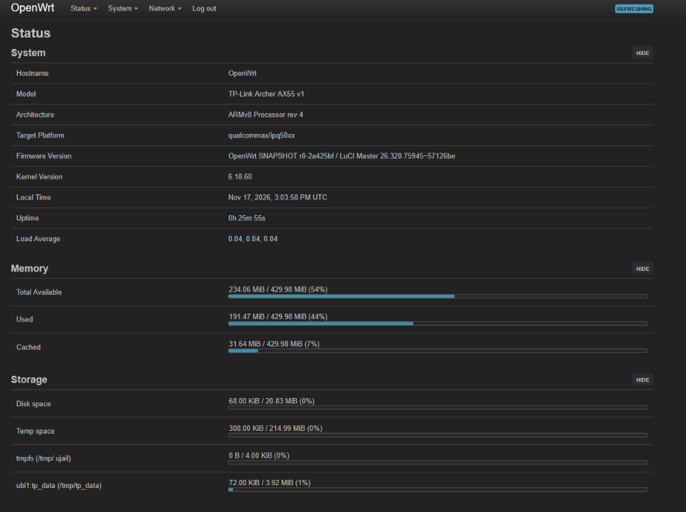

# OpenWrt Installation Guide & Build Tools for TP-Link Archer AX55 v1

This repository provides instructions, scripts, and patches to build and install OpenWrt on the **TP-Link Archer AX55 v1** wireless router without requiring a hardware serial (UART) connection.



---

## Hardware Specifications

| Component | Specification |
| :--- | :--- |
| **Model** | TP-Link Archer AX55 (Hardware Version: v1) |
| **SoC** | Qualcomm IPQ5018 (Dual-Core ARM Cortex-A53 @ 1.0 GHz) |
| **RAM** | 512 MB DDR3L |
| **Flash Storage** | 128 MB SPI NAND Flash |
| **Ethernet Switch** | Realtek RTL8367S (DSA switch) |
| **Wi-Fi 2.4 GHz** | Qualcomm IPQ5018 (802.11b/g/n/ax, 2x2 MIMO) |
| **Wi-Fi 5 GHz** | Qualcomm QCN6102 / QCN6122 (802.11a/n/ac/ax, 2x2 MIMO, 160 MHz) |
| **USB** | 1x USB 3.0 Type-A |

---

## Architecture & Installation Concept

Official TP-Link firmware images enforce signature checks during recovery mode, but standard web upgrades on stock releases prior to encrypted branches accept repacked images whose MD5 header checksum has been updated.

1. **Repacked Stock Base**: Unpack an unencrypted stock image (e.g. version 1.3.3), enable `telnetd` in `/etc/rc.local`, fix the header checksum, and flash via the web interface.
2. **Intermediate RAM Boot**: Using Telnet access, write `openwrt-initramfs-factory.ubi` to the inactive flash slot and switch the boot slot environment variable (`tp_boot_idx`).
3. **Permanent Upgrade**: Once booted into OpenWrt in RAM, run `sysupgrade -n` with the permanent `squashfs-sysupgrade.bin` containing the LuCI web interface.

---

## Repository Structure

```
├── configs/
│   └── ubinize-ipq50xx.cfg      # UBI volume layout configuration
├── patches/
│   └── serdes-timing-fix.patch  # Fix for IPQ5018 / RTL8367S switch link initialization
├── scripts/
│   ├── 01-unpack.sh             # Unpack stock firmware UBI/squashfs
│   ├── 02-repack.sh             # Repack modified rootfs with MD5 fix
│   ├── Makefile                 # Builds the local MD5 checksum tool
│   ├── md5-fix.c                # C utility to compute header checksums
│   └── build-openwrt.sh         # Automates source compilation in Linux/WSL
├── .gitignore                   # Excludes binaries, images, and archives
└── README.md
```

---

## Prerequisites (Linux / WSL)

Install the necessary compilation and unpack utilities:

```bash
sudo apt update
sudo apt install -y build-essential gcc make libssl-dev mtd-utils squashfs-tools python3 python3-pip
pip install ubi_reader
```

---

## Step 1: Create the Telnet-Enabled Stock Firmware

1. Place your unencrypted stock firmware (`.bin`) in the workspace.
2. Unpack the image as root:
   ```bash
   sudo ./scripts/01-unpack.sh stock_firmware.bin
   ```
3. Enable Telnet in `squashfs-root/etc/rc.local` by adding this line before `exit 0`:
   ```bash
   telnetd -l /bin/sh &
   ```
4. Repack the firmware:
   ```bash
   sudo ./scripts/02-repack.sh ax55-repacked-telnet.bin
   ```
5. Navigate to the router web UI (`http://192.168.0.1`), open **Advanced** -> **System Tools** -> **Firmware Upgrade**, and upload `ax55-repacked-telnet.bin`.

---

## Step 2: Switch Hardware Verification

Once the router reboots, connect via Telnet:

```bash
telnet 192.168.0.1
```

Verify your internal switch model:

```bash
dmesg | grep -o 'find rtk switch [0-9]*'
```

* **`find rtk switch 0`**: Supported RTL8367S switch. Proceed to the next step.
* **Other or empty**: Stop installation (indicates an alternative revision that lacks driver support in standard OpenWrt).

---

## Step 3: Flash OpenWrt via RAM Boot

1. Start an HTTP server on your PC (e.g. `python3 -m http.server 8000`) hosting `openwrt-initramfs-factory.ubi`.
2. In the router Telnet session:
   ```bash
   cd /tmp
   wget http://<PC_IP>:8000/openwrt-initramfs-factory.ubi -O factory.ubi
   fw_printenv tp_boot_idx
   cat /proc/mtd | grep -E '"rootfs"|"rootfs_1"'
   ```
3. Identify the inactive partition. For example, if active is `tp_boot_idx=1` (`rootfs_1`), write to `mtd11` (`rootfs`):
   ```bash
   mtd erase /dev/mtd11
   mtd write /tmp/factory.ubi /dev/mtd11
   fw_setenv tp_boot_idx 0
   fw_setenv config_name config@mp03.3
   reboot
   ```

---

## Step 4: Final Permanent OpenWrt Installation

1. After rebooting, the router starts OpenWrt in RAM at `192.168.1.1`.
2. Connect via SSH:
   ```bash
   ssh root@192.168.1.1
   ```
3. Download and flash the permanent sysupgrade image:
   ```bash
   cd /tmp
   wget http://<PC_IP>:8000/openwrt-squashfs-sysupgrade.bin -O sysupgrade.bin
   sysupgrade -n /tmp/sysupgrade.bin
   ```
4. The router writes the permanent flash and reboots into OpenWrt with LuCI enabled.

---

## Step 5: Web Interface & Wi-Fi Configuration

1. Connect your PC to a LAN port and open `http://192.168.1.1` in your browser.
2. Log in (default password is empty) and set an administrative password under **System** -> **Administration**.
3. Under **Network** -> **Wireless**, edit both radios:
   * `radio0`: 2.4 GHz (802.11ax)
   * `radio1`: 5 GHz (802.11ax)
   Set your SSID and WPA2/WPA3 credentials, then click **Enable** and **Save & Apply**.

---

## Recovery Procedure (Return to OEM)

The Archer AX55 features a built-in hardware recovery mode in U-Boot:

1. Configure your PC with static IP `192.168.0.10` / subnet `255.255.255.0` and connect via Ethernet to LAN 1.
2. Turn off the router.
3. Hold the **Reset button** while powering on, keep holding for 10 seconds, then release.
4. Navigate to `http://192.168.0.1` in your web browser.
5. Upload an official signed TP-Link firmware image to restore factory software.

---

## License

All original scripts and documentation in this repository are released under the MIT License.
OpenWrt patches and build files adhere to the GNU General Public License v2 (GPL-2.0).
